
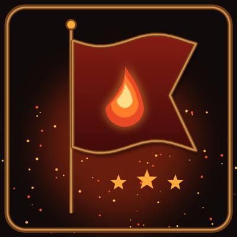

[English](#english) · [Deutsch](#deutsch) · [Screenshots](#screenshots)

World of Warcraft addon for Retail (Midnight 12.x) and WoW Forever · Author: Rage Quitters Anonymous · CurseForge project 1771937

---

## English

**Your guild, front and center.** GuildPride replaces the default guild window with a fully styled guild hub: milestones, events, guild info, a group finder, guild chat and member management in one place. Works for any guild: the window automatically shows your guild name, tag and tabard. English and German.

### Features
- **New guild window**: opens with **J** or the guild button in the micro menu. Your guild name at the top, your guild tag and tabard on the left. `/gp blizzard` switches back to Blizzard's window
- **Milestones with badges**: when a member reaches level 10, 20, 30 … 90, every guildmate with GuildPride sees an animated pop-up with a badge. Missed milestones are fetched from other members at login
- **Join and leave alerts**: a clear notice when someone joins, leaves or is removed
- **Event planner**: officers create events with title, date and time (separate fields), description and officer note. Members of every rank sign up as Attending, Maybe or Declined with their role. Reminder 15 minutes before the start
- **Group finder and quest help**: sign up with a note and the roles you still need. Everyone sees class, level, role, zone and how full the group is. **Join** sends a join request, **Invite** invites a solo player, right-click whispers. Open to every rank
- **Guild info**: the info text from Blizzard's guild window, the same for everyone, with a notice when it changes. It is edited in Blizzard's guild window (Blizzard blocks addons from changing it)
- **Guild chat and communities**: guild chat, officer chat and your Blizzard communities inside the window, with the server-side history plus a local copy so old messages keep their author names
- **Members list**: your guild or any of your communities, online only or everyone, with rank, notes and "last online"
- **Invite players** to the guild or a community: type a name, or right-click a member
- **Guild management**: click a member to see notes and to promote, demote, set a rank, remove or transfer leadership (depending on your rights)
- **Community management**: right-click a member to change their role, edit their note or remove them
- **Polls**: officers create polls with up to 6 answers and an optional duration, everyone votes
- **More milestones**: achievements, first raid boss kills, new M+ bests and new mounts
- **Event lineup**: role check for group or raid and "Invite all attendees" for officers
- **Recruiting text and note templates**, plus a settings page in the WoW options (`/gp options`)
- **Version check**: a reminder when a newer version is in use in the guild

### Commands
- `/gp` or `/guildpride` open the window, `/gp help` all commands
- `/gp sound`, `/gp popup` turn sounds and pop-ups on or off
- `/gp blizzard` switch between GuildPride and the Blizzard guild window
- `/gp tag XYZ` set the guild tag (without tag: automatic)
- `/gp invite Name-Realm` invite a player to the guild
- `/gp badge 30` preview a milestone pop-up, `/gp version` who uses which version

### Good to know
- Milestones, events and the group finder sync between guild members who have GuildPride installed
- Data is shared only with your guild through addon messages; members who can't write in guild chat send through an online guildmate
- During Blizzard's chat lockdown in instances, addon messages wait and are sent afterwards
- Guild data also travels over a hidden, password-protected background channel of your guild, so syncing does not depend on guild chat rank rights.

### Installation
Copy the `GuildPride` folder to `World of Warcraft/_retail_/Interface/AddOns`, or install it with the CurseForge app.

---

## Deutsch

**Deine Gilde im Mittelpunkt.** GuildPride ersetzt das normale Gildenfenster durch einen komplett gestalteten Gilden-Treffpunkt: Meilensteine, Events, Gildeninfo, Gruppensuche, Gildenchat und Mitgliederverwaltung an einem Ort. Funktioniert für jede Gilde: Das Fenster zeigt automatisch euren Gildennamen, euer Kürzel und euren Wappenrock. Deutsch und Englisch.

### Funktionen
- **Neues Gildenfenster**: öffnet sich mit **J** oder über den Gildenknopf in der Mikroleiste. Oben euer Gildenname, links euer Kürzel und Wappenrock. `/gp blizzard` schaltet zurück zum Blizzard-Fenster
- **Meilensteine mit Abzeichen**: erreicht jemand Level 10, 20, 30 … 90, sehen alle mit GuildPride ein animiertes Popup mit Abzeichen. Verpasste Meilensteine werden beim Einloggen von anderen Mitgliedern nachgeladen
- **Hinweis bei Beitritt und Austritt**: eine deutliche Meldung, wenn jemand beitritt, geht oder entfernt wird
- **Event-Planer**: Offiziere legen Events mit Titel, Datum und Uhrzeit (getrennte Felder), Beschreibung und Offiziers-Notiz an. Mitglieder aller Ränge melden sich mit Zusagen, Vielleicht oder Absagen und ihrer Rolle an. Erinnerung 15 Minuten vor Beginn
- **Gruppensuche und Quest-Hilfe**: mit Notiz und fehlenden Rollen eintragen. Alle sehen Klasse, Level, Rolle, Zone und wie voll die Gruppe ist. **Beitreten** schickt eine Beitrittsanfrage, **Einladen** lädt einen Einzelspieler ein, Rechtsklick flüstert an. Für alle Ränge
- **Gildeninfo**: der Info-Text aus dem Blizzard-Gildenfenster, für alle gleich, mit Hinweis bei Änderungen. Bearbeitet wird er im Blizzard-Gildenfenster (Blizzard sperrt das Ändern für Addons)
- **Gildenchat und Communities**: Gildenchat, Offizierschat und eure Blizzard-Communities direkt im Fenster, mit Verlauf vom Server und lokaler Kopie, damit alte Nachrichten ihren Namen behalten
- **Mitgliederliste**: eure Gilde oder jede eurer Communities, nur online oder alle, mit Rang, Notizen und „zuletzt online“
- **Spieler einladen** in die Gilde oder eine Community: Namen eingeben oder Rechtsklick auf ein Mitglied
- **Gildenverwaltung**: Klick auf ein Mitglied zeigt die Notizen, dort befördern, degradieren, Rang setzen, entfernen oder Gildenleitung übergeben (je nach deinen Rechten)
- **Community-Verwaltung**: Rechtsklick auf ein Mitglied, um die Rolle zu ändern, die Notiz zu bearbeiten oder es zu entfernen
- **Umfragen**: Offiziere legen Umfragen mit bis zu 6 Antworten und wahlweiser Laufzeit an, alle stimmen ab
- **Mehr Meilensteine**: Erfolge, erste Raidboss-Siege, neue M+-Bestleistungen und neue Reittiere
- **Event-Aufstellung**: Rollen-Check für Gruppe oder Schlachtzug und „Alle Zugesagten einladen“ für Offiziere
- **Werbetext und Notiz-Vorlagen**, dazu eine Einstellungsseite in den WoW-Optionen (`/gp optionen`)
- **Versionscheck**: Erinnerung, wenn in der Gilde eine neuere Version genutzt wird

### Befehle
- `/gp` oder `/guildpride` Fenster öffnen, `/gp hilfe` alle Befehle
- `/gp sound`, `/gp popup` Sounds und Popups an oder aus
- `/gp blizzard` zwischen GuildPride und dem Blizzard-Gildenfenster wechseln
- `/gp kuerzel XYZ` Gildenkürzel festlegen (ohne Kürzel: automatisch)
- `/gp einladen Name-Realm` Spieler in die Gilde einladen
- `/gp badge 30` Meilenstein-Popup testen, `/gp version` wer welche Version nutzt

### Gut zu wissen
- Meilensteine, Events und Gruppensuche werden zwischen Gildenmitgliedern abgeglichen, die GuildPride installiert haben
- Daten gehen nur an eure Gilde per Addon-Nachricht; wer nicht im Gildenchat schreiben darf, sendet über ein Mitglied, das online ist
- Während der Blizzard-Chat-Sperre in Instanzen warten Addon-Nachrichten und werden danach gesendet
- Gildendaten laufen zusätzlich über einen versteckten, passwortgeschützten Hintergrund-Kanal eurer Gilde, damit der Abgleich nicht von Rangrechten im Gildenchat abhängt.

### Installation
Den Ordner `GuildPride` nach `World of Warcraft/_retail_/Interface/AddOns` kopieren oder über die CurseForge-App installieren.

---

## Screenshots

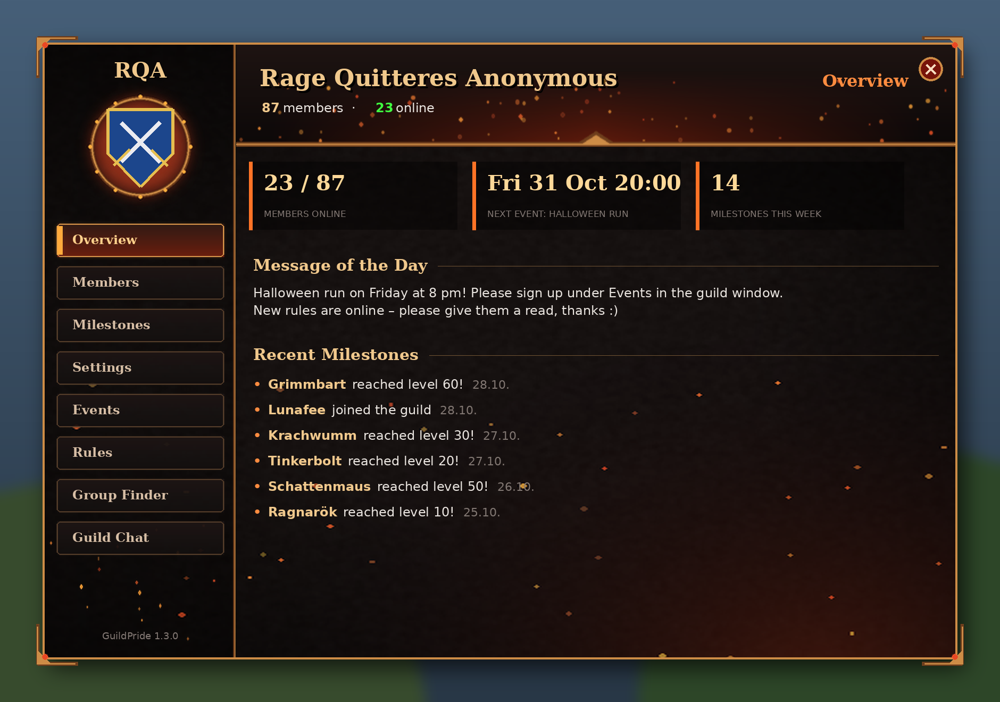

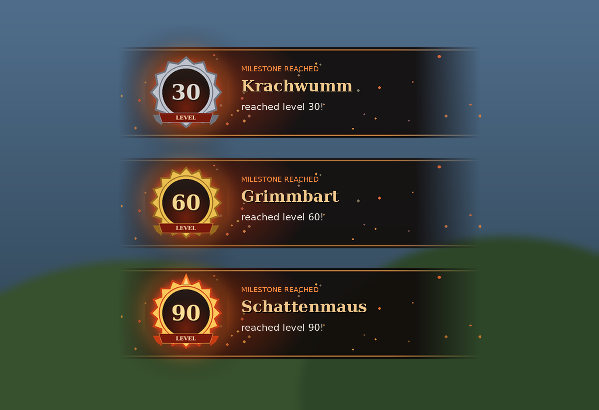

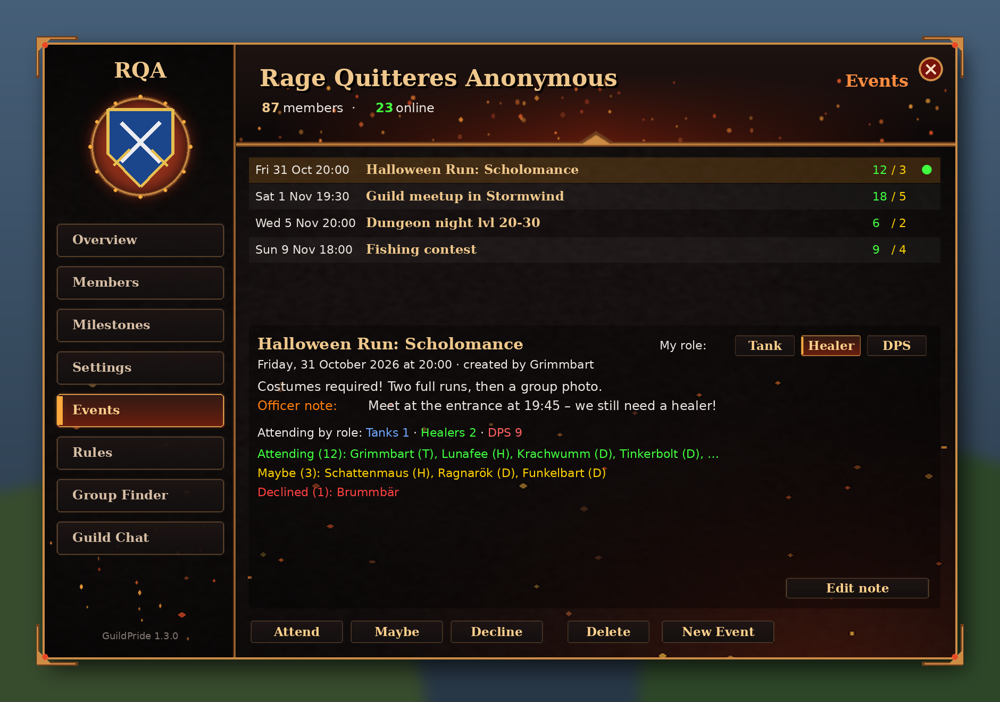

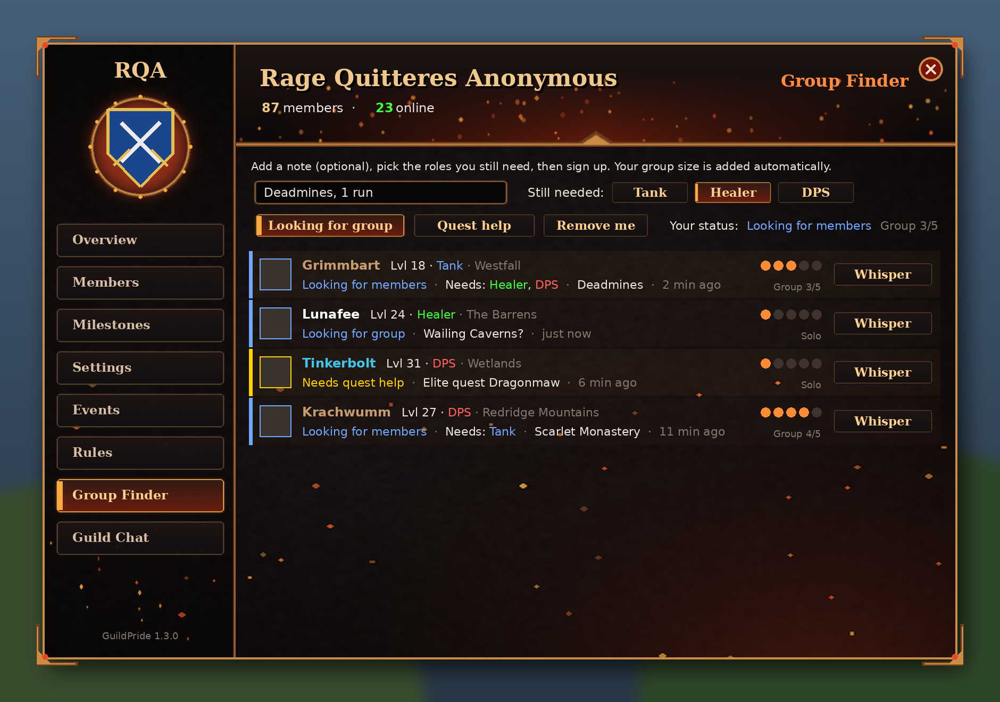

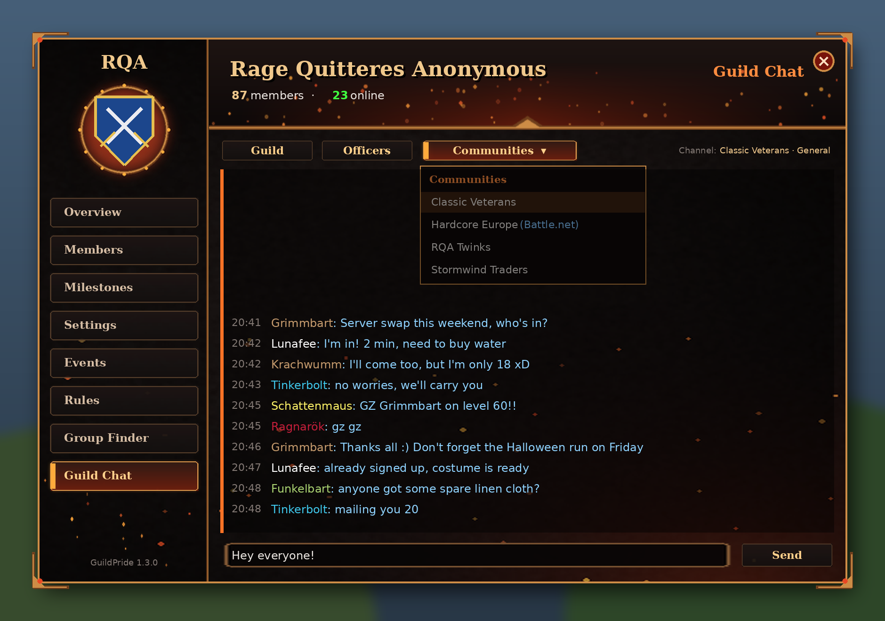

Deutsche Screenshots

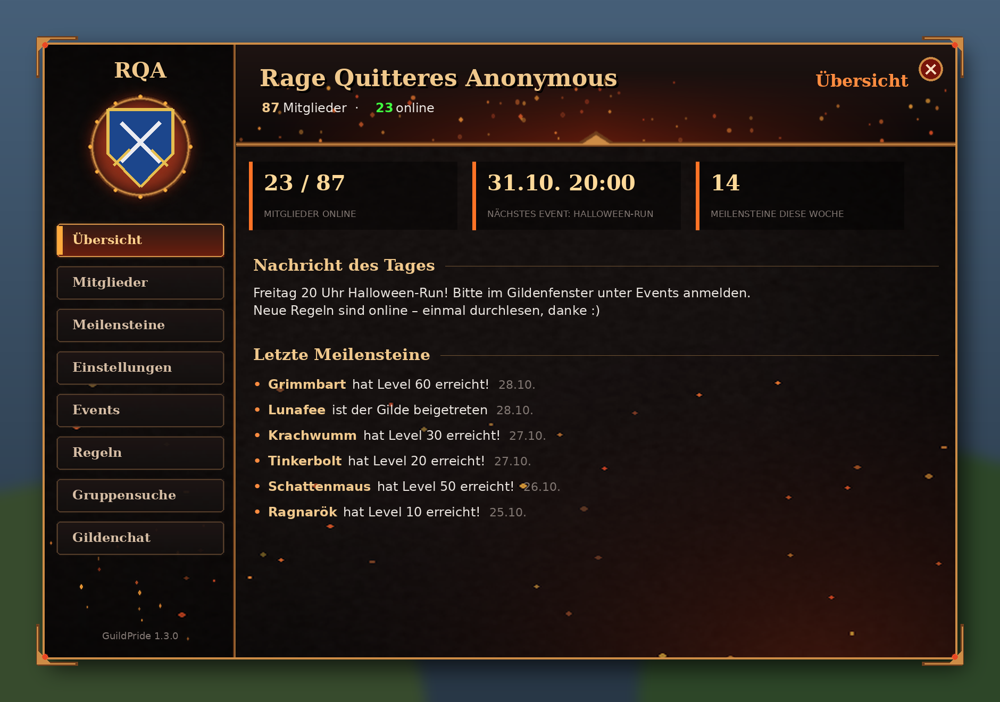

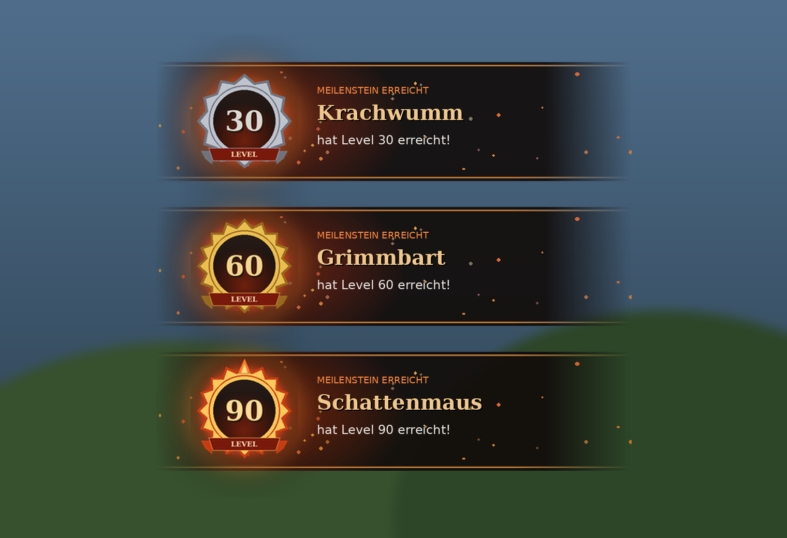

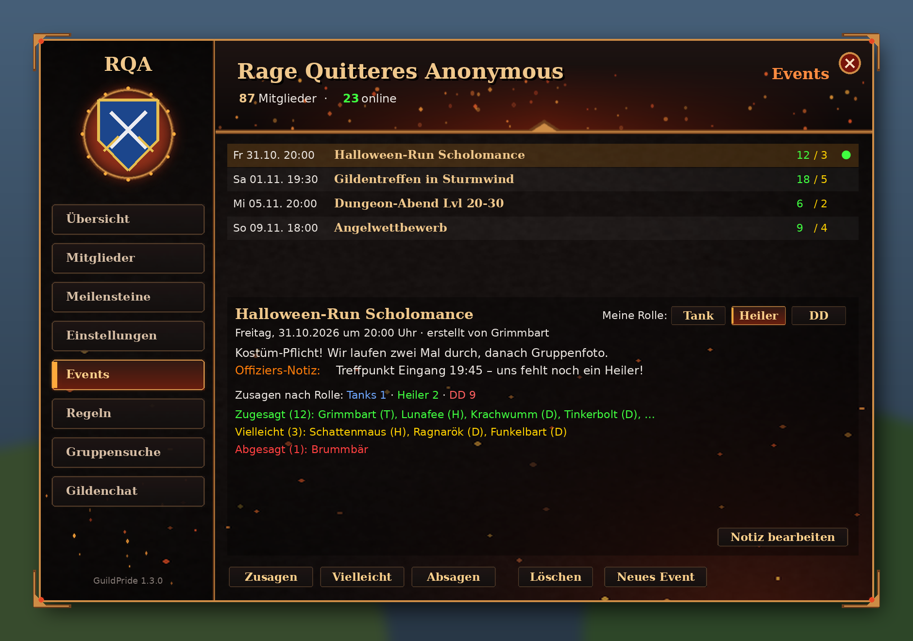

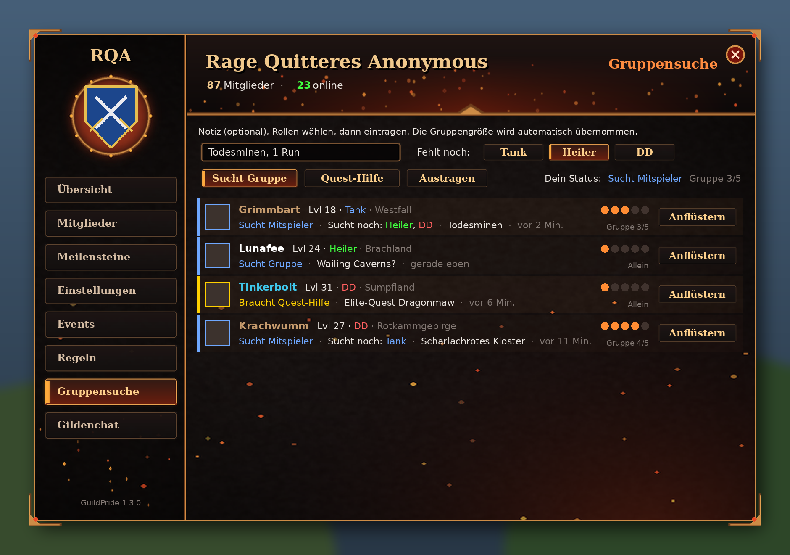

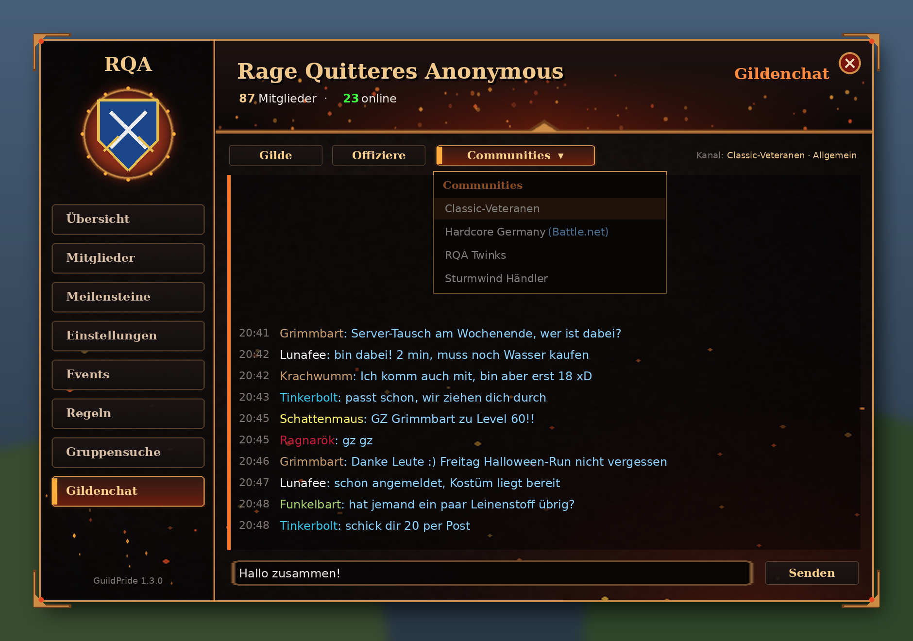

