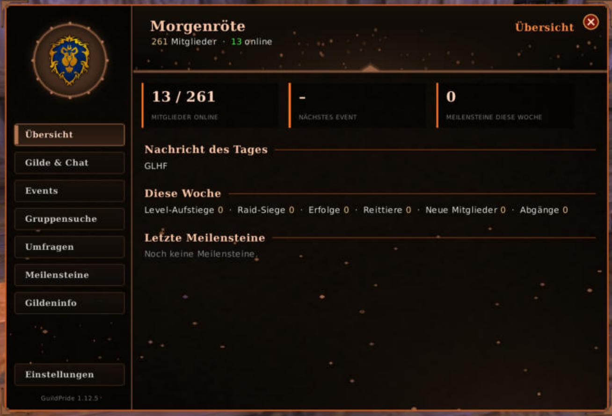
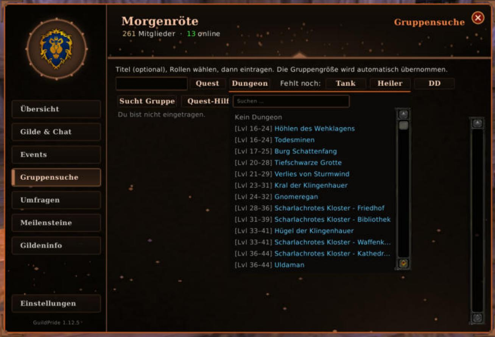
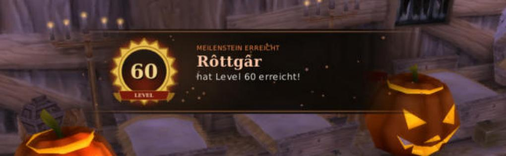
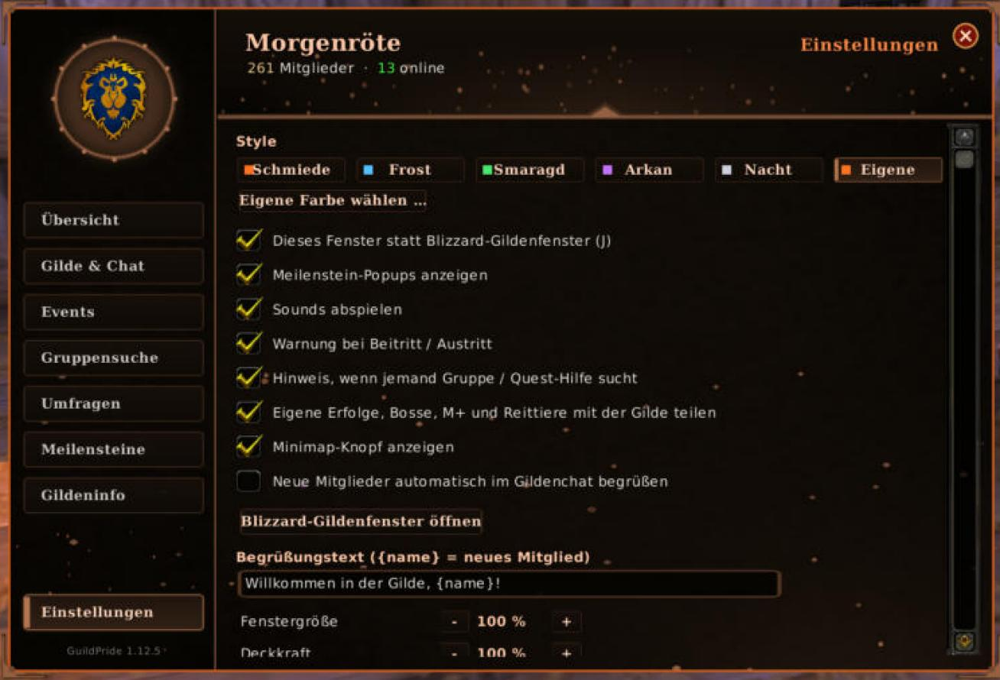

[English](#english) · [Deutsch](#deutsch) · [Screenshots](#screenshots)

World of Warcraft addon for Retail (Midnight 12.x), WoW Forever and all Classic versions · Author: Rottgar85 · CurseForge project 1771937

---

## English

**Your guild, front and center.** GuildPride replaces the default guild window with a fully styled guild hub: milestones, events, guild info, a group finder, guild chat and member management in one place. Works for any guild: the window automatically shows your guild name and your faction logo (Horde or Alliance). English and German.

### Features
- **New guild window**: opens with **J** or the guild button in the micro menu. Your guild name at the top, your faction logo on the left. `/gp blizzard` switches back to Blizzard's window
- **Milestones with badges**: when a member reaches level 10, 20, 30 … 90, every guildmate with GuildPride sees an animated pop-up with a badge. Missed milestones are fetched from other members at login
- **Join and leave alerts**: a clear notice when someone joins, leaves or is removed
- **Event planner**: officers create events with title, date and time (separate fields), description and officer note. Members of every rank sign up as Attending, Maybe or Declined with their role. Reminder 15 minutes before the start
- **Group finder and quest help**: sign up with a note and the roles you still need. Everyone sees class, level, role, zone and how full the group is. **Join** sends a join request, **Invite** invites a solo player, right-click whispers. Open to every rank
- **Server-wide group finder**: optionally also see and reach everyone on your server with GuildPride – each game version separately, without guild names. Switch between Guild · Server · All, hide players, `/gp server` turns it off
- **Guild info**: the info text from Blizzard's guild window, the same for everyone, with a notice when it changes. It is edited in Blizzard's guild window (Blizzard blocks addons from changing it)
- **Guild & Chat**: guild chat, officer chat and your Blizzard communities with the members right next to the chat, like Blizzard's community window. Server-side history plus a local copy so old messages keep their author names
- **Members list**: one click from the chat to the full list of your guild or community, online only or everyone, with rank, notes and "last online"
- **Styles**: Forge, Frost, Emerald, Arcane, Night and Custom, switchable any time in the settings
- **Invite players** to the guild or a community: type a name, or right-click a member
- **Guild management**: click a member to see notes and to promote, demote, set a rank, remove or transfer leadership (depending on your rights)
- **Community management**: right-click a member to change their role, edit their note or remove them
- **Polls**: officers create polls with up to 6 answers and an optional duration, everyone votes
- **More milestones**: achievements, first raid boss kills, new M+ bests and new mounts
- **Event lineup**: role check for group or raid and "Invite all attendees" for officers
- **Recruiting text and note templates**, plus a settings page in the WoW options (`/gp options`)
- **Version check**: a reminder when a newer version is in use in the guild
- **Search and sort members**: search by name, rank, note or zone; click a column header (name, level, rank, last online) to sort, click again to reverse
- **Unread counts and mentions**: guild, officer and community buttons, the community menu and the Guild & Chat tab show how many messages are unread. Lines with your name get a » and gold text
- **Guild keystones** (Retail only): everyone with GuildPride shares keystone and M+ rating. "Guild keystones" in the group finder, the key in the member list and tooltip. Hidden in WoW Forever
- **This week** on the overview: level-ups, raid kills, M+ bests (Retail), achievements, mounts, joins, departures and the busiest member
- **For officers**: "Inactive" filter (30+, 60+, 90+ days), automatic welcome message, weekly recurring events and attendance tracking
- **Minimap button**, a custom style with your own color, and adjustable window size, opacity and chat font

### Commands
- `/gp` or `/guildpride` open the window, `/gp help` all commands
- `/gp sound`, `/gp popup` turn sounds and pop-ups on or off
- `/gp blizzard` switch between GuildPride and the Blizzard guild window
- `/gp invite Name-Realm` invite a player to the guild
- `/gp server` server-wide group finder on or off, `/gp server unblock` shows hidden players again
- `/gp badge 30` preview a milestone pop-up, `/gp version` who uses which version

### Good to know
- Milestones, events and the group finder sync between guild members who have GuildPride installed
- Data is shared only with your guild through addon messages; members who can't write in guild chat send through an online guildmate
- During Blizzard's chat lockdown in instances, addon messages wait and are sent afterwards
- Guild data also travels over a hidden, password-protected background channel of your guild, so syncing does not depend on guild chat rank rights.

### Installation
Copy the `GuildPride` folder to `World of Warcraft/_retail_/Interface/AddOns` (Classic: `_classic_`, `_classic_era_`, `_anniversary_`; WoW Forever: `_forever_`), or install it with the CurseForge app. Works in Retail, WoW Forever and all Classic versions.

---

## Deutsch

**Deine Gilde im Mittelpunkt.** GuildPride ersetzt das normale Gildenfenster durch einen komplett gestalteten Gilden-Treffpunkt: Meilensteine, Events, Gildeninfo, Gruppensuche, Gildenchat und Mitgliederverwaltung an einem Ort. Funktioniert für jede Gilde: Das Fenster zeigt automatisch euren Gildennamen und das Logo eurer Fraktion (Horde oder Allianz). Deutsch und Englisch.

### Funktionen
- **Neues Gildenfenster**: öffnet sich mit **J** oder über den Gildenknopf in der Mikroleiste. Oben euer Gildenname, links das Logo eurer Fraktion. `/gp blizzard` schaltet zurück zum Blizzard-Fenster
- **Meilensteine mit Abzeichen**: erreicht jemand Level 10, 20, 30 … 90, sehen alle mit GuildPride ein animiertes Popup mit Abzeichen. Verpasste Meilensteine werden beim Einloggen von anderen Mitgliedern nachgeladen
- **Hinweis bei Beitritt und Austritt**: eine deutliche Meldung, wenn jemand beitritt, geht oder entfernt wird
- **Event-Planer**: Offiziere legen Events mit Titel, Datum und Uhrzeit (getrennte Felder), Beschreibung und Offiziers-Notiz an. Mitglieder aller Ränge melden sich mit Zusagen, Vielleicht oder Absagen und ihrer Rolle an. Erinnerung 15 Minuten vor Beginn
- **Gruppensuche und Quest-Hilfe**: mit Notiz und fehlenden Rollen eintragen. Alle sehen Klasse, Level, Rolle, Zone und wie voll die Gruppe ist. **Beitreten** schickt eine Beitrittsanfrage, **Einladen** lädt einen Einzelspieler ein, Rechtsklick flüstert an. Für alle Ränge
- **Serverweite Gruppensuche**: auf Wunsch auch alle auf dem Server mit GuildPride sehen und erreichen – jede Spielversion für sich, ohne Gildennamen. Umschaltbar zwischen Gilde · Server · Alle, Spieler ausblendbar, `/gp server` schaltet es ab
- **Gildeninfo**: der Info-Text aus dem Blizzard-Gildenfenster, für alle gleich, mit Hinweis bei Änderungen. Bearbeitet wird er im Blizzard-Gildenfenster (Blizzard sperrt das Ändern für Addons)
- **Gilde & Chat**: Gildenchat, Offizierschat und eure Blizzard-Communities, die Mitglieder direkt neben dem Chat wie im Blizzard-Community-Fenster. Verlauf vom Server und lokale Kopie, damit alte Nachrichten ihren Namen behalten
- **Mitgliederliste**: ein Klick vom Chat zur großen Liste eurer Gilde oder Community, nur online oder alle, mit Rang, Notizen und „zuletzt online“
- **Styles**: Schmiede, Frost, Smaragd, Arkan, Nacht und Eigene, jederzeit in den Einstellungen umschaltbar
- **Spieler einladen** in die Gilde oder eine Community: Namen eingeben oder Rechtsklick auf ein Mitglied
- **Gildenverwaltung**: Klick auf ein Mitglied zeigt die Notizen, dort befördern, degradieren, Rang setzen, entfernen oder Gildenleitung übergeben (je nach deinen Rechten)
- **Community-Verwaltung**: Rechtsklick auf ein Mitglied, um die Rolle zu ändern, die Notiz zu bearbeiten oder es zu entfernen
- **Umfragen**: Offiziere legen Umfragen mit bis zu 6 Antworten und wahlweiser Laufzeit an, alle stimmen ab
- **Mehr Meilensteine**: Erfolge, erste Raidboss-Siege, neue M+-Bestleistungen und neue Reittiere
- **Event-Aufstellung**: Rollen-Check für Gruppe oder Schlachtzug und „Alle Zugesagten einladen“ für Offiziere
- **Werbetext und Notiz-Vorlagen**, dazu eine Einstellungsseite in den WoW-Optionen (`/gp optionen`)
- **Versionscheck**: Erinnerung, wenn in der Gilde eine neuere Version genutzt wird
- **Mitglieder suchen und sortieren**: Suche nach Name, Rang, Notiz oder Zone; Klick auf einen Spaltenkopf (Name, Level, Rang, zuletzt online) sortiert, erneuter Klick dreht die Richtung
- **Ungelesen und Erwähnungen**: Gilde, Offiziere, Communities, das Community-Menü und der Reiter Gilde & Chat zeigen, wie viele Nachrichten ungelesen sind. Zeilen mit deinem Namen bekommen ein » und goldene Schrift
- **Schlüssel der Gilde** (nur Retail): alle mit GuildPride teilen Schlüsselstein und M+-Wertung. „Schlüssel der Gilde“ in der Gruppensuche, der Schlüssel in Mitgliederliste und Tooltip. In WoW Forever ausgeblendet
- **Diese Woche** auf der Übersicht: Level-Aufstiege, Raid-Siege, M+-Bestwerte (Retail), Erfolge, Reittiere, Beitritte, Abgänge und das fleißigste Mitglied
- **Für Offiziere**: Filter „Inaktive“ (30+, 60+, 90+ Tage), automatische Begrüßung, wöchentlich wiederholte Events und Anwesenheit
- **Minimap-Knopf**, eigener Style mit selbst gewählter Farbe, dazu einstellbare Fenstergröße, Deckkraft und Chat-Schrift

### Befehle
- `/gp` oder `/guildpride` Fenster öffnen, `/gp hilfe` alle Befehle
- `/gp sound`, `/gp popup` Sounds und Popups an oder aus
- `/gp blizzard` zwischen GuildPride und dem Blizzard-Gildenfenster wechseln
- `/gp einladen Name-Realm` Spieler in die Gilde einladen
- `/gp server` serverweite Gruppensuche an oder aus, `/gp server entsperren` zeigt ausgeblendete Spieler wieder
- `/gp badge 30` Meilenstein-Popup testen, `/gp version` wer welche Version nutzt

### Gut zu wissen
- Meilensteine, Events und Gruppensuche werden zwischen Gildenmitgliedern abgeglichen, die GuildPride installiert haben
- Daten gehen nur an eure Gilde per Addon-Nachricht; wer nicht im Gildenchat schreiben darf, sendet über ein Mitglied, das online ist
- Während der Blizzard-Chat-Sperre in Instanzen warten Addon-Nachrichten und werden danach gesendet
- Gildendaten laufen zusätzlich über einen versteckten, passwortgeschützten Hintergrund-Kanal eurer Gilde, damit der Abgleich nicht von Rangrechten im Gildenchat abhängt.

### Installation
Den Ordner `GuildPride` nach `World of Warcraft/_retail_/Interface/AddOns` kopieren (Classic: `_classic_`, `_classic_era_`, `_anniversary_`; WoW Forever: `_forever_`) oder über die CurseForge-App installieren. Läuft in Retail, WoW Forever und allen Classic-Versionen.

---

## Screenshots

*In-game screenshots (German client) · Spiel-Screenshots*

